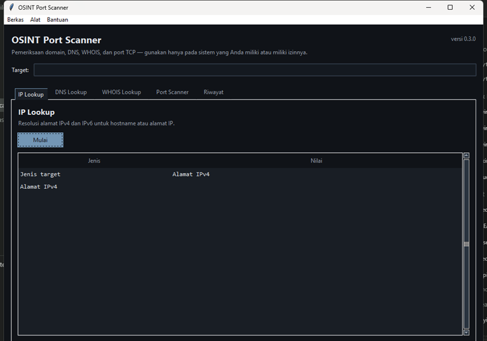
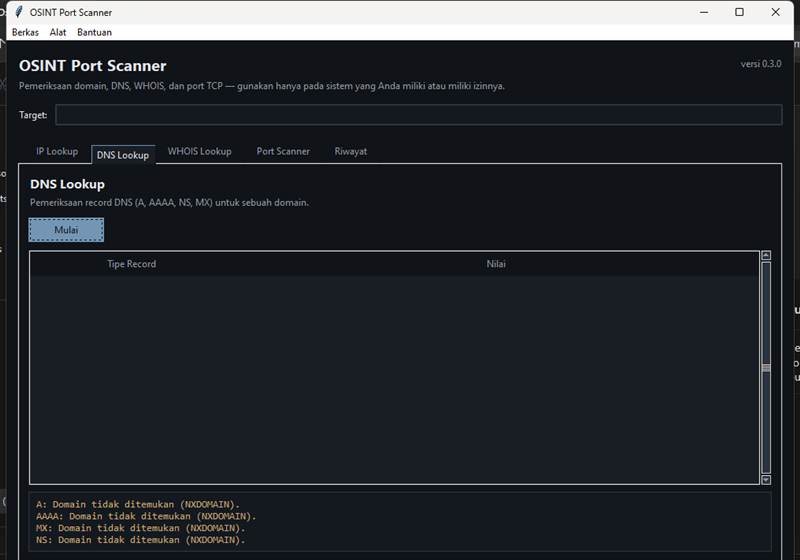
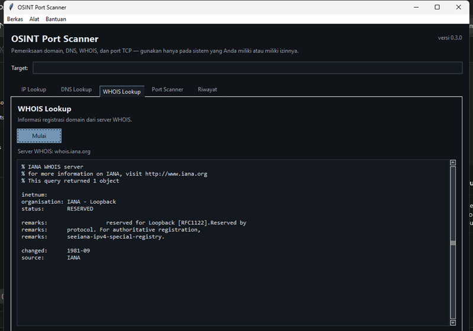
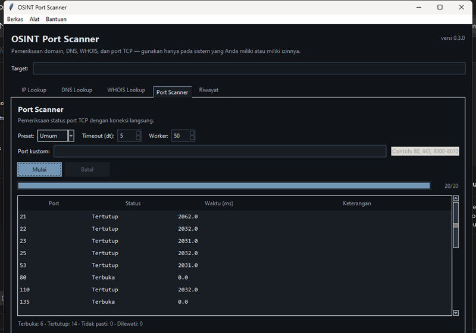
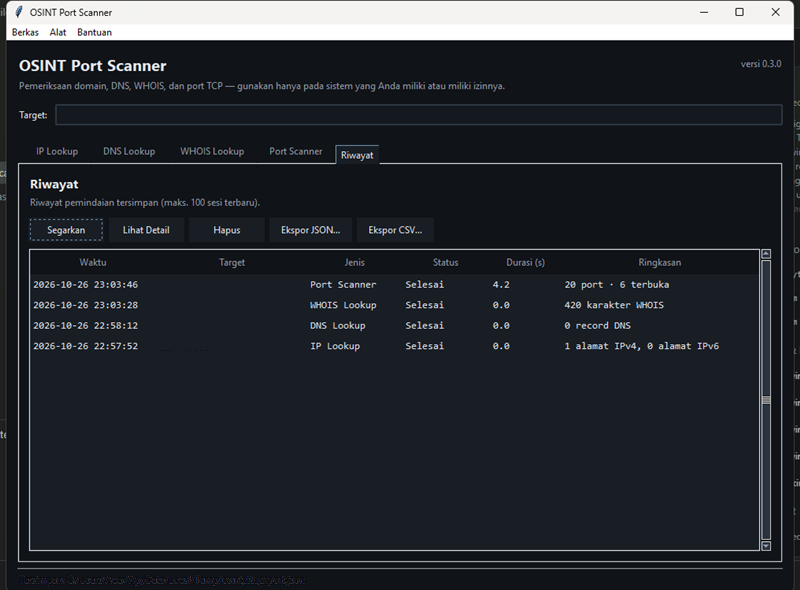

# OSINT Port Scanner

Aplikasi desktop untuk pencarian informasi IP, DNS, WHOIS, dan pemindaian
port TCP pada satu target. Antarmuka grafisnya dibangun dengan Tkinter
bertema gelap, dan seluruh teks antarmuka menggunakan Bahasa Indonesia.

Versi 0.3.0

> **Catatan hukum dan etika**
>
> Gunakan aplikasi ini **hanya pada sistem milik Anda sendiri atau sistem
> yang secara tertulis Anda izinkan untuk diuji**. Memindai sistem pihak
> lain tanpa izin dapat melanggar hukum dan ketentuan layanan jaringan
> terkait. Alat ini dibuat untuk keperluan belajar, latihan CTF, dan
> pengujian keamanan yang sah.

## Gambaran Umum

OSINT Port Scanner adalah aplikasi jaringan yang berjalan sepenuhnya di
mesin pengguna. Setiap pemeriksaan (IP, DNS, WHOIS, port) dilakukan
langsung oleh aplikasi — tidak ada layanan perantara, tidak ada data yang
dikirim ke pihak ketiga, dan tidak ada telemetri. Hasil pemeriksaan
ditampilkan di antarmuka, dapat diekspor ke JSON/CSV, dan riwayat sesi
disimpan lokal dalam database SQLite.

Aplikasi ini mulai dikembangkan sebagai kerangka proyek kosong berusia
sekitar satu setengah tahun, lalu dibangun ulang bertahap menjadi
aplikasi yang berfungsi penuh. Seluruh modul inti (pemindai port,
pemeriksaan DNS, WHOIS, lapisan penyimpanan, dan antarmuka) ditulis dari
nol dalam tahapan tersebut, dan setiap tahap diuji dengan rangkaian tes
otomatis.

## Fitur Utama

- **IP Lookup** — memvalidasi target (alamat IPv4, IPv6, atau hostname)
  dan menampilkan alamat hasil resolusi melalui resolver sistem.
- **DNS Lookup** — menanyakan record A, AAAA, NS, dan MX menggunakan
  dnspython. Kegagalan per jenis record dilaporkan apa adanya, tidak
  pernah direkayasa.
- **WHOIS Lookup** — mengambil respons mentah melalui protokol WHOIS
  (port TCP 43): menanyakan `whois.iana.org` terlebih dahulu untuk
  menemukan server registri TLD, lalu menampilkan respons dari server
  tersebut.
- **TCP Port Scanner** — pemindaian koneksi TCP dengan preset **Umum**,
  **Extended**, dan **Kustom**, timeout dan jumlah worker yang dapat
  diatur, pembatasan laju koneksi, bilah progres, dapat dibatalkan, dan
  tabel hasil yang dapat diurutkan.
- **Riwayat** — sesi pemindaian tersimpan lokal di SQLite (maksimal 100
  sesi terbaru) dengan status Selesai/Gagal/Dibatalkan, detail per sesi,
  dan fitur penghapusan.
- **Ekspor** — JSON untuk semua jenis pemeriksaan; CSV khusus hasil
  pemindaian port; keduanya berformat UTF-8.
- **Pengaturan** — timeout, jumlah worker maksimum, dan laju koneksi,
  tersimpan di `config.json`.

Status port dilaporkan apa adanya: **Terbuka** (koneksi berhasil),
**Tertutup** (koneksi ditolak/di-reset secara eksplisit), atau
**Tidak pasti** (timeout atau kondisi lain yang tidak bisa disimpulkan —
tidak pernah dianggap sama dengan tertutup). Port yang dilewati karena
pembatalan dihitung sebagai "Dilewati" dan tidak difabrikasi.

## Teknologi

- Python 3.12 (versi 3.9 ke atas didukung), memanfaatkan pustaka standar
  sejauh memungkinkan
- Tkinter/ttk dengan tema `clam` dan palet warna gelap buatan sendiri
- dnspython untuk pemeriksaan record DNS — satu-satunya dependensi pihak
  ketiga saat runtime
- SQLite (modul standar `sqlite3`) untuk penyimpanan riwayat lokal
- PyInstaller (mode onedir) untuk distribusi Windows
- unittest untuk rangkaian tes

## Screenshot

| | |
|---|---|
|  |  |
|  |  |
|  | |

## Persyaratan Sistem

**Executable Windows:** Windows 10 atau 11. Tidak memerlukan instalasi
Python.

**Dari kode sumber:** Python 3.9 atau lebih baru (diuji pada 3.12.2)
dengan Tkinter, yang sudah termasuk dalam installer standar dari
python.org. Fitur pemeriksaan memerlukan akses jaringan untuk menjangkau
resolver DNS, server WHOIS, dan target pemindaian.

## Instalasi dan Menjalankan

### Dari kode sumber

```bat
cd osint_scanner
pip install -r requirements.txt
python main.py
```

Alternatifnya, `pip install .` memasang paket beserta dependensinya.
Satu-satunya dependensi pihak ketiga adalah `dnspython>=2.6,<3`.

Lokasi data saat dijalankan dari kode sumber:

- `config.json` — pengaturan aplikasi, di folder proyek
- `scans.db` — riwayat pemindaian (SQLite), di folder proyek

Keduanya bersifat lokal dan sudah tercantum di `.gitignore`.

### Executable Windows

Executable didistribusikan sebagai build **onedir**: sebuah folder berisi
`OSINTPortScanner.exe` beserta direktori `_internal` yang memuat runtime
terbundel. Tidak ada installer.

1. Salin **seluruh folder** `OSINTPortScanner` — jangan menyalin
   `.exe`-nya sendirian.
2. Klik dua kali `OSINTPortScanner.exe`.

Aplikasi berjalan tanpa jendela konsol dan tidak memerlukan Python.
Pengaturan dan riwayat disimpan di `%LOCALAPPDATA%\OSINT Port Scanner`
(dibuat otomatis). Executable tidak pernah menulis ke folder
instalasinya.

Untuk membangun executable sendiri, jalankan `packaging\build_windows.bat`.
Skrip ini membuat virtual environment terisolasi di `packaging\venv`
untuk PyInstaller, sehingga tidak ada yang terpasang secara global.
Hasil build: `dist\OSINTPortScanner\OSINTPortScanner.exe`.

Catatan:

- Peringatan SmartScreen ("Windows protected your PC") adalah hal yang
  wajar untuk executable tanpa tanda tangan. Jika Anda membangun sendiri
  dan memercayai kode sumbernya, pilih *More info → Run anyway*.
- Peringatan antivirus juga umum untuk alat pemindai port (deteksi
  heuristik). Tambahkan pengecualian untuk folder aplikasi jika Anda
  memercayainya.

## Panduan Penggunaan

Satu kolom **Target** di bagian atas jendela dipakai bersama oleh semua
tab. Bilah menu berisi **Berkas**, **Alat**, dan **Bantuan**.

### IP Lookup

Masukkan alamat IP (misalnya `8.8.8.8` atau `::1`) atau hostname, lalu
klik **Mulai**. Tabel menampilkan jenis target (alamat IPv4, alamat IPv6,
atau hostname) dan semua alamat hasil resolusi. Input yang tidak valid
menghasilkan pesan error, bukan hasil yang direkayasa.

### DNS Lookup

Masukkan nama domain lalu klik **Mulai**. Record A, AAAA, NS, dan MX
ditampilkan dalam tabel. Jika salah satu jenis record gagal (NXDOMAIN,
tidak ada record, timeout resolver), kegagalannya dicantumkan di panel
bawah tabel sementara jenis record lain tetap ditampilkan. Kueri menuju
resolver DNS sistem; tidak ada layanan pihak ketiga yang terlibat.

### WHOIS Lookup

Masukkan nama domain lalu klik **Mulai**. Aplikasi menghubungi
`whois.iana.org` untuk menemukan server registri TLD terkait, lalu
menampilkan respons mentah dari server tersebut. Respons bersifat
**mentah** — formatnya berbeda-beda antar registrar. Jika tidak ada
server yang merespons, pesan beserta alasannya ditampilkan.

### Port Scanner

1. Masukkan target (alamat IP atau hostname).
2. Pilih preset:
   - **Umum** — 20 port yang umum digunakan (21–8443).
   - **Extended** — port 1–1024.
   - **Kustom** — daftar port sendiri di kolom "Port kustom",
     misalnya `80, 443, 8000-8010` (koma/spasi sebagai pemisah,
     tanda hubung untuk rentang).
3. Atur **Timeout** (0,5–60 detik per upaya koneksi) dan **Worker**
   (1–500 thread paralel). Nilai di luar rentang ditolak.
4. Klik **Mulai**. Bilah progres dan tabel hasil terisi secara bertahap.
5. Klik **Batal** untuk menghentikan. Pembatalan bersifat kooperatif:
   socket yang sedang dalam proses koneksi menunggu timeout-nya, dan
   port yang belum diperiksa dihitung sebagai **Dilewati**.

Arti status port:

| Status | Arti |
|---|---|
| Terbuka | Koneksi TCP berhasil dibangun |
| Tertutup | Koneksi ditolak/di-reset secara eksplisit |
| Tidak pasti | Timeout atau kondisi lain — tidak bisa disimpulkan, dan **tidak** dianggap sama dengan tertutup |

Pembatasan laju koneksi aktif secara bawaan (10 koneksi/detik) dan dapat
diubah di Pengaturan. Nilai 0 menonaktifkannya (tidak disarankan).

### Riwayat

Setiap pemeriksaan yang selesai tersimpan otomatis selama "Simpan
riwayat" diaktifkan. Tab **Riwayat** menampilkan sesi dengan status
**Selesai**, **Gagal**, atau **Dibatalkan**. Tombol bilah alat:
**Segarkan**, **Lihat Detail** (menampilkan hasil lengkap sebagai JSON),
**Hapus** (menghapus sesi, dengan konfirmasi), serta **Ekspor JSON… /
Ekspor CSV…** (mengekspor ulang sesi lama). Riwayat hanya tersimpan
lokal di `scans.db`.

### Mengekspor Hasil

- **Berkas → Ekspor JSON…** — menyimpan hasil pemeriksaan terakhir
  sebagai JSON UTF-8 (semua jenis pemeriksaan).
- **Berkas → Ekspor CSV…** — hanya tersedia untuk hasil pemindaian port
  (kolom: `port,status,duration_ms,error`). Gunakan JSON untuk hasil
  IP/DNS/WHOIS.
- Membatalkan dialog simpan tidak membuat file apa pun. Error penulisan
  (misalnya folder tujuan tidak ada) ditampilkan sebagai pesan error.

### Pengaturan

**Alat → Pengaturan** mengubah nilai bawaan timeout pemindaian
(0,5–60 dtk), worker maksimum (1–500), dan laju koneksi (0–1000/detik,
dengan sakelar aktif/nonaktif). Nilai divalidasi dan disimpan di
`config.json`.

Menutup jendela saat pemindaian berjalan meminta konfirmasi. Jika
dikonfirmasi, pemindaian dibatalkan, sesi disimpan dengan status
"Dibatalkan", lalu jendela tertutup.

### Mengatasi Masalah

| Gejala | Penyebab dan solusi |
|---|---|
| `ModuleNotFoundError: No module named 'dns'` | Jalankan `pip install -r requirements.txt` |
| Tkinter tidak ditemukan | Pasang Python dari python.org (opsi tcl/tk aktif) |
| `Error loading config: …` saat startup | `config.json` korup — aplikasi memakai nilai bawaan dan menulis ulang file tersebut |
| Semua port "Tidak pasti" | Hal yang wajar: timeout tidak berarti tertutup. Perilaku pada loopback Windows bisa berbeda-beda — kadang sistem menjawab RST sehingga port tercatat "Tertutup", kadang tidak ada jawaban sehingga tercatat "Tidak pasti" |
| Pembatalan terasa lambat | Socket yang sedang dalam proses koneksi menunggu timeout-nya (paling lama sesuai nilai yang diatur) |
| `scans.db` korup | Hapus file tersebut — aplikasi membuatnya ulang saat startup (riwayat lama hilang) |

## Pengujian

```bat
python -m unittest discover -v
```

104 tes (unit + GUI + integrasi lokal), berjalan sekitar 10 detik. Tes
jaringan hanya menggunakan localhost dengan listener sementara; DNS dan
WHOIS diuji dengan mock — tidak ada target publik yang dihubungi.

## Batasan dan Etika Penggunaan

Batasan teknis yang perlu diketahui:

- Port Scanner hanya melakukan pemeriksaan koneksi TCP. **Tidak ada**
  deteksi layanan, pengambilan banner, identifikasi versi, OS
  fingerprinting, pemindaian stealth (SYN), pemindaian UDP, pemindaian
  subnet, atau pemeriksaan kerentanan.
- Status "Tidak pasti" tidak selalu bisa dibedakan secara pasti dari
  kondisi jaringan lain — artinya hanya bahwa upaya koneksi tidak
  berhasil atau tidak selesai tepat waktu.
- Pembatalan bersifat kooperatif dan tidak memutus paksa socket yang
  sedang dalam proses koneksi; koneksi tersebut selesai atau timeout
  terlebih dahulu.
- WHOIS memakai timeout tetap 10 detik yang tidak bisa diatur lewat
  dialog pengaturan.
- Hasil DNS dan WHOIS bergantung pada ketersediaan jaringan serta
  resolver dan server registri yang terlibat.
- Preset Extended (port 1–1024) dengan laju koneksi rendah bisa memakan
  waktu lama.
- Antarmuka pengguna berbahasa Indonesia.

Aplikasi ini **tidak** melakukan deteksi layanan/banner/versi aplikasi,
pemeriksaan kerentanan (CVE, default credentials, SSL/web scanner),
pemindaian stealth atau UDP, enumerasi subdomain, pemanenan email, atau
fingerprinting sistem operasi. Tidak ada telemetri: hasil pemindaian
tidak pernah meninggalkan mesin Anda. Satu-satunya koneksi keluar adalah
ke target pemindaian, resolver DNS sistem, dan server WHOIS.

Gunakan aplikasi ini untuk belajar dan untuk menguji sistem yang Anda
miliki atau berwenang untuk menguji. Pindai hanya target yang secara
eksplisit Anda izinkan, dan hormati batas laju serta ketentuan layanan
setiap jaringan yang terlibat. Pengembang tidak bertanggung jawab atas
penyalahgunaan.

## Struktur Folder

```
main.py                  titik masuk aplikasi
config/settings.py       penanganan konfigurasi (config.json)
database/models.py       DatabaseManager (SQLite)
database/queries.py      penyimpanan/pemuatan hasil pemeriksaan
scanner/network/         port_scanner (koneksi TCP)
scanner/reconnaissance/  dns_enum, whois_enhanced
scanner/utils/           ip_utils, rate_limiter, threading_manager
gui/                     main_window, scan_tabs, worker, exports,
                         results_viewer, settings_dialog, theme
packaging/               spec PyInstaller, info versi, skrip build
tests/                   rangkaian tes unittest
docs/                    spesifikasi teknis, referensi API, screenshot
```
